<p align="center">
  
</p>

<h1 align="center">sloodle</h1>

<p align="center">
  <strong>The harness for learning anything.</strong><br>
  <em>Hey Stupid, it's time to learn.</em>
</p>

<p align="center">
  <a href="LICENSE"></a>
</p>

<p align="center">
  
</p>

Type what you want to learn. **Sloo**, a plush owl tutor, asks about your goal, researches how the subject is best
taught, builds you a course, and then teaches it with you in a chat full of things to do: diagrams, runnable code,
flashcards, drag-into-order puzzles, worked examples, pictures. Sloo can read aloud in a voice that runs on your own
computer, remembers how you learn from what you actually do, and gets better at teaching you over time.

sloodle is a desktop app. Your courses and everything Sloo knows about you stay in a folder on your machine. The
thinking is done by Claude, through **your own Claude subscription** (or an Anthropic API key, if you prefer).

> **Early days.** sloodle has only been built and run on Linux so far. Nothing has been tested on macOS or Windows,
> and there are no packaged releases yet: you run it from source (below).

<p align="center">
  🎬 <a href="docs/readme/sloodle-ad.mp4"><strong>Watch the 47-second ad</strong></a> (MP4, 5 MB)
</p>

---

## Contents

[What it does](#what-it-does) ·
[How it works](#how-it-works) ·
[The open course format](#the-open-course-format) ·
[Privacy](#privacy-and-what-leaves-your-machine) ·
[Run it](#run-it-from-source) ·
[Develop](#develop) ·
[Status](#status-and-roadmap) ·
[Credits](#credits) ·
[Licence](#licence)

## What it does

### Say what you want to learn

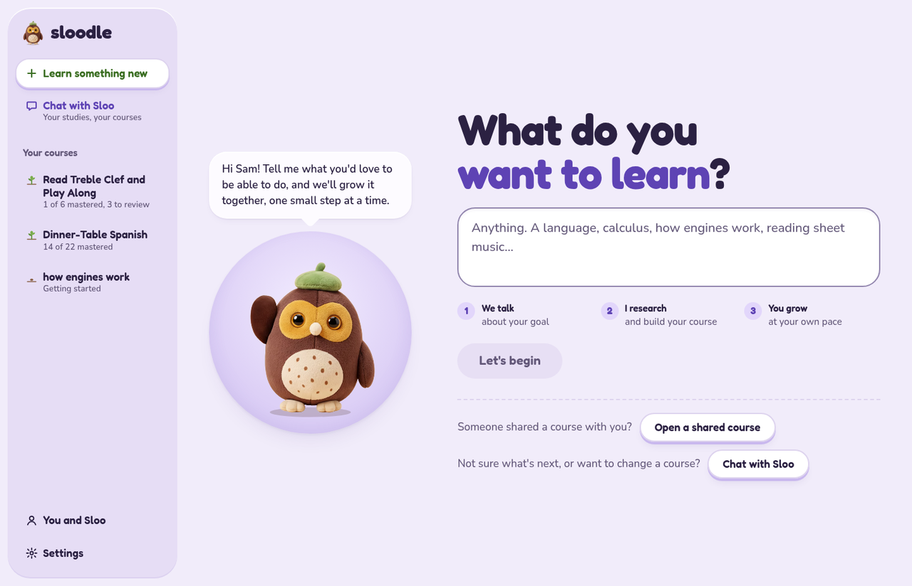

A language, calculus, how engines work, reading sheet music. Sloo opens with a short conversation about the outcome
you want, why you want it, how much time you have, and what you already know. Then a planner searches the web for how
the subject is best taught and designs the course backward from your goal: modules, objectives you can observe,
prerequisites between them, small projects, and the sources it used.

### A course that grows with you

<table>
  <tr>
    <td width="50%">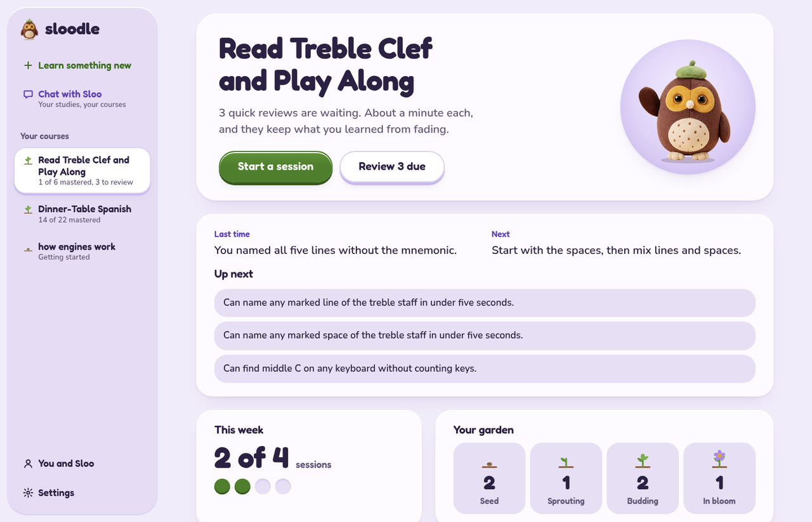</td>
    <td width="50%">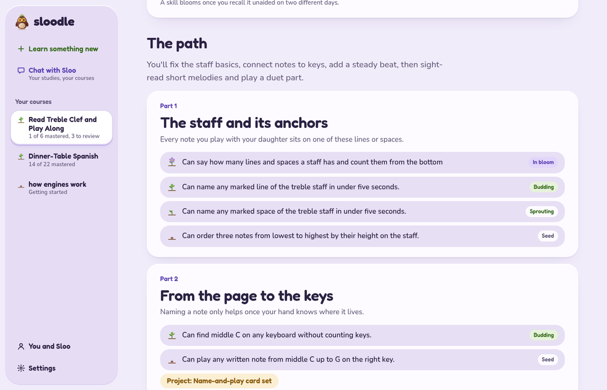</td>
  </tr>
</table>

Every skill is a plant: seed, sprouting, budding, in bloom. A skill only blooms after you get it right **without help
on two different days**, a rule the code enforces rather than the model. Facts worth keeping become review cards,
scheduled with [FSRS](https://github.com/open-spaced-repetition/ts-fsrs) so they come back just before you would
forget them. The weekly goal is forgiving, and there are no streaks to lose.

### Lessons you do, not just read

<p align="center">
  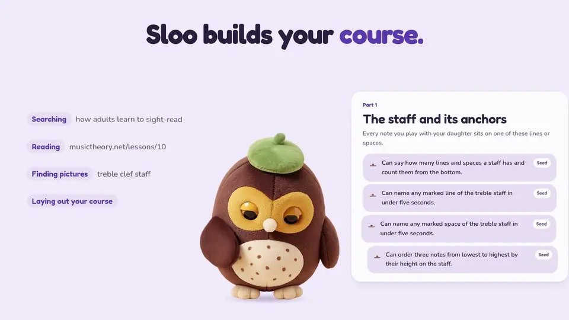
</p>

Sloo teaches one or two objectives at a time in a chat, and the lesson plan is made of components the interface
renders and grades:

| Component | What it is |
| --- | --- |
| **Diagram** | Flowcharts, sequence diagrams and concept maps, drawn with Mermaid |
| **Code** | Highlighted code; JavaScript can be run in a sealed sandbox with no network and a time limit |
| **Put in order** | Drag the steps or items into the right order |
| **Match** | Pair each item with its partner, with distractors |
| **Fill in the blanks** | Prose or code with gaps |
| **Worked example** | Steps revealed one at a time, predicting each next step first |
| **Flashcard** | Recall, flip, rate how it went |
| **Table** and **Callout** | Comparisons, key ideas, common mistakes |
| **Picture** | Openly licensed images from Wikimedia Commons, with credits |

<p align="center">
  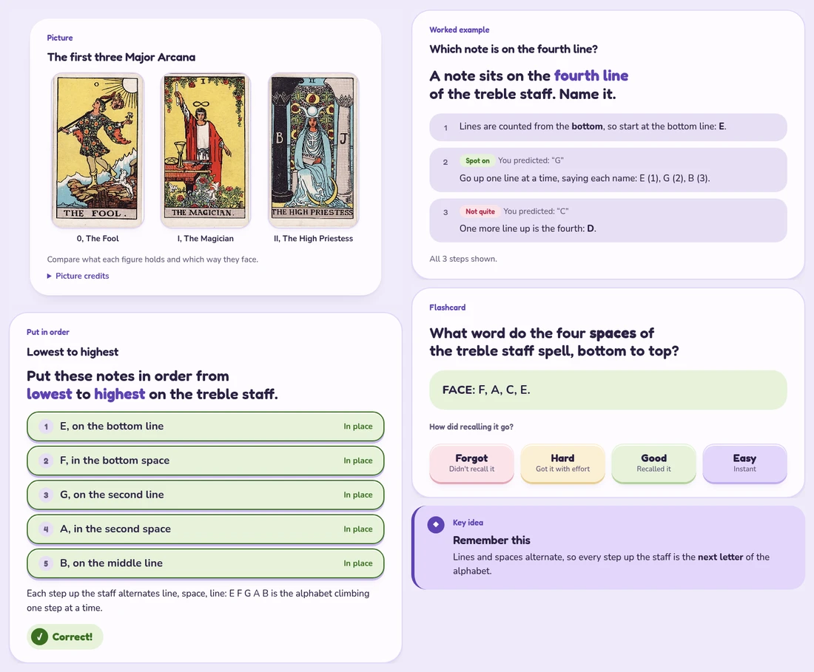
</p>

The learner does the thinking. Questions come with a ladder of hints, and Sloo does not hand over the answer to a
practice problem. Written answers are graded in a separate model call against an answer key written before the lesson,
so the tutor cannot be talked into agreeing with you.

<table>
  <tr>
    <td width="50%">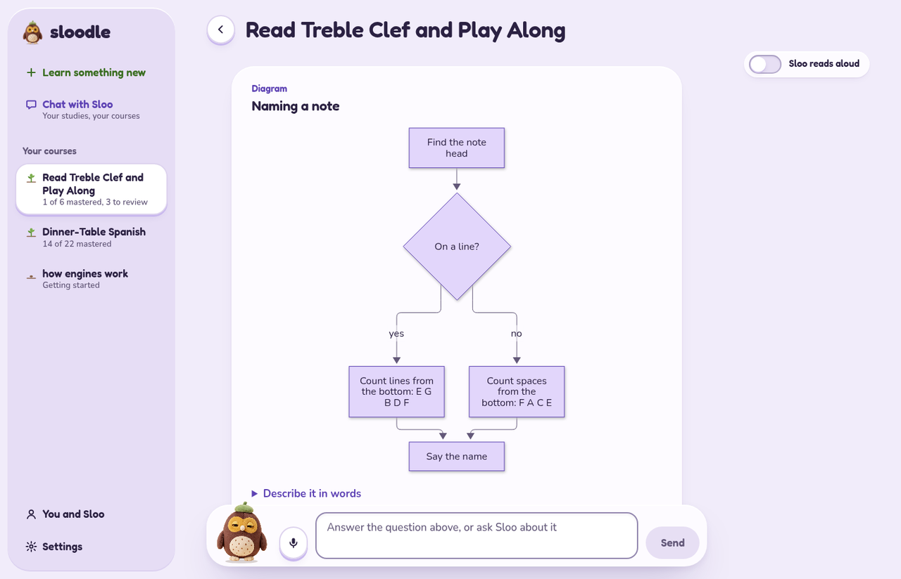</td>
    <td width="50%">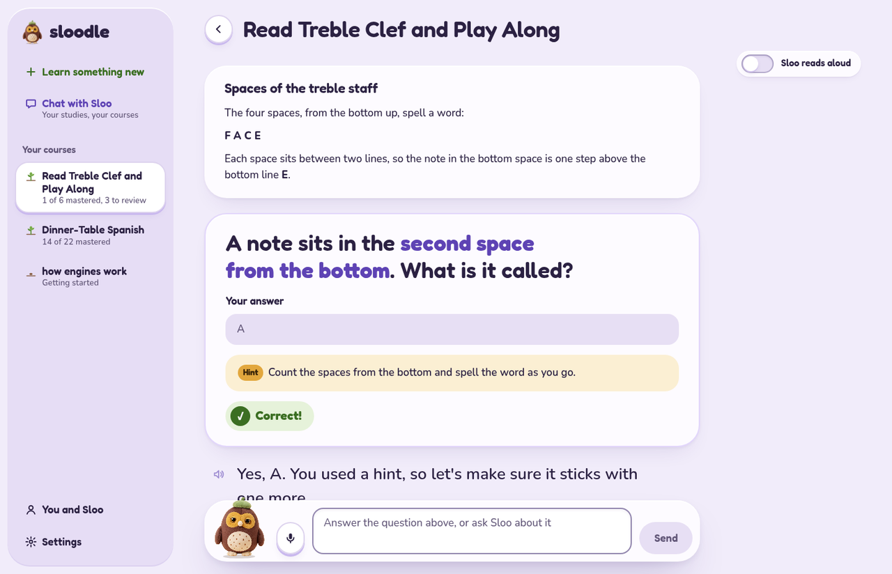</td>
  </tr>
</table>

### Sloo talks, listens and chimes

- **Read aloud.** Sloo can speak its replies with [Kokoro](https://huggingface.co/onnx-community/Kokoro-82M-v1.0-ONNX),
  a small voice model that runs locally.
- **Answer by speaking.** Press the microphone and talk; speech is turned into text on your computer with Whisper.
- **Audio lessons.** Turn any part of a course into a listening lesson for a walk or the commute, with pauses for
  recall questions.
- **Sounds.** Small chimes for answers, reviews and skills that grow, synthesized live with Web Audio from one
  little instrument. No sound files are shipped.

### Chat with Sloo about the whole journey

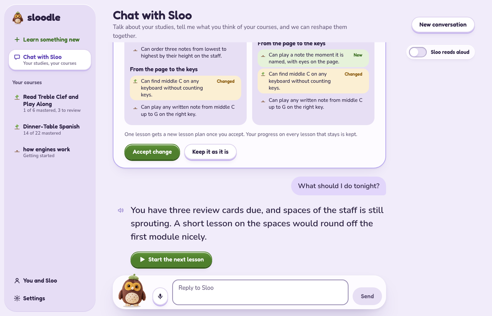

Outside any lesson there is one ongoing conversation with Sloo that knows all your courses, what you have mastered and
what is due. Ask what to do tonight, say a course is too slow, or ask for a new module. When Sloo suggests a change
to a course it shows you the before and after, and **nothing changes until you press Accept**.

### Sloo learns how you learn

<table>
  <tr>
    <td width="50%">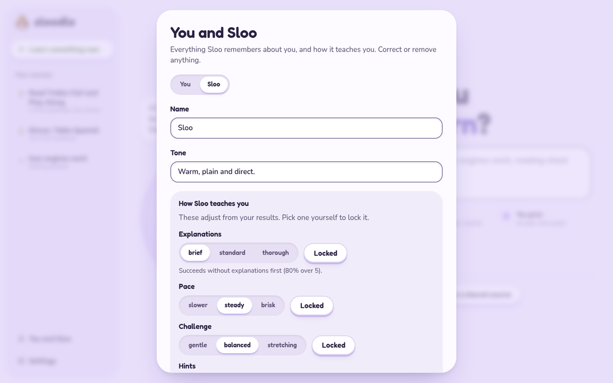</td>
    <td width="50%">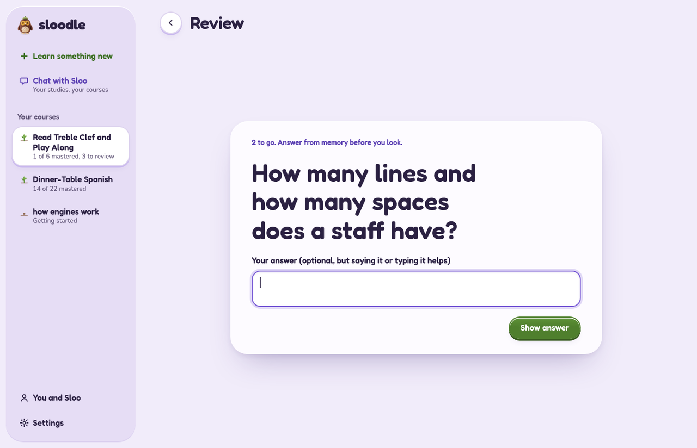</td>
  </tr>
</table>

Two documents hold what Sloo knows, instead of a long chat history:

- **Your learner profile**: what you told Sloo (each note with its source and date) and an observed profile computed
  by code from your activity: accuracy and hints by question kind, how well your confidence matches your results, pace,
  time of day, which kinds of material came before success. Every number names the events behind it.
- **Sloo's own teaching memory**: how deep to explain, how fast to go, how hard to push, which tactics worked. It
  shifts by fixed rules over your observed profile and by a schema-checked reflection after each session, one step at a
  time, and every change is logged.

You can read, correct, lock or delete all of it under **You and Sloo**. Nobody gets sorted into a "learning style".

### Share a course as one file

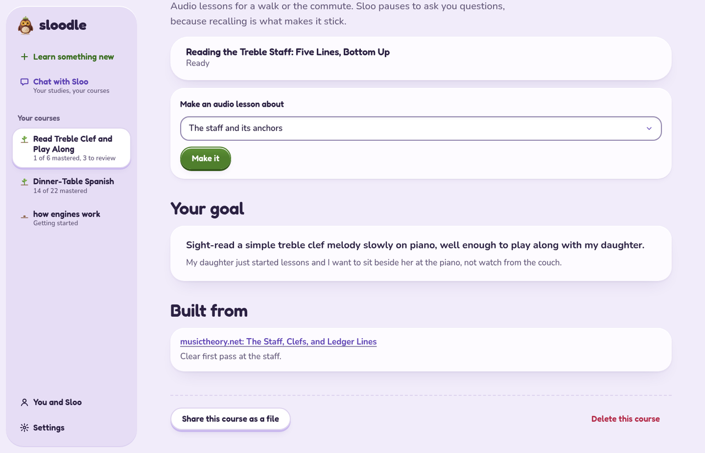

**Share this course as a file** writes a single `.sloodle.json` with the whole course, lesson plans and pictures
included, and nothing personal. Anyone with sloodle can open it with **Open a shared course** and start fresh with
their own progress. Imported files are size-limited, validated strictly, cleaned, and their text is treated as data
when it reaches the model.

## How it works

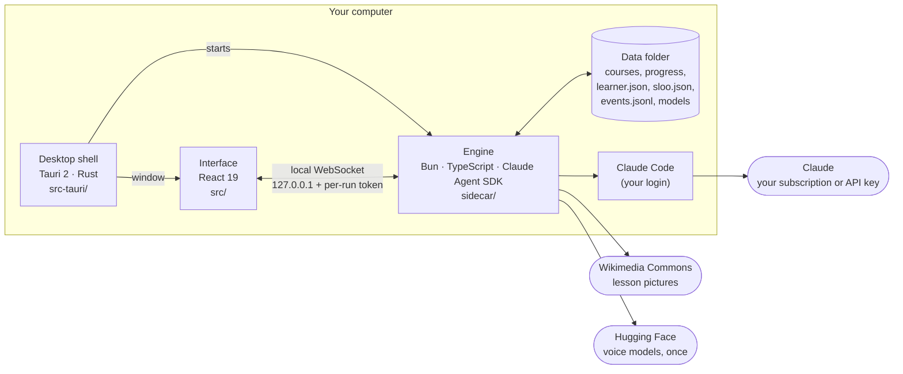

- **Shell** (`src-tauri/`): a small Tauri 2 app. It starts the engine, reads the port and token it prints, and hands
  them to the window.
- **Interface** (`src/`): React 19, built with [UI SDK](https://ui-sdk.dev) components, Fredoka and Nunito, Mermaid
  for diagrams and highlight.js for code.
- **Engine** (`sidecar/`): Bun and TypeScript. It runs the Claude Agent SDK sessions (interview, planning, lessons,
  chat, grading, reflection), the learner model, review scheduling, speech, and course import and export. It listens
  only on `127.0.0.1`, and every request needs the token of that run.
- **Data folder**: `~/.local/share/sloodle` on Linux (`SLOODLE_DATA` overrides it). Plain JSON and JSONL files you can
  read: `settings.json`, `learner.json`, `sloo.json`, `events.jsonl`, `courses/<id>/course.json` and `progress.json`,
  the chat, and the downloaded voice models. Older data is migrated on start, with the originals kept in `backups/`.

The model sessions run with `settingSources: []`, so your own Claude Code settings and `CLAUDE.md` never leak into
the tutor. Teaching rules the model must not skip live in code (`sidecar/src/session.ts`, `sidecar/src/learner.ts`),
not only in the prompts (`sidecar/src/prompts.ts`).

## The open course format

Everything sloodle saves is a versioned, documented format, defined once with zod in
[`sidecar/src/formats.ts`](sidecar/src/formats.ts). JSON Schemas generated from it live in
[`sidecar/schema/`](sidecar/schema/):

| Format | What it holds |
| --- | --- |
| [`sloodle.course`](sidecar/schema/sloodle.course.v1.schema.json) | A course anyone can be taught from: modules, objectives, lesson plans, checks with answer keys, review cards, sources. Nothing personal. |
| [`sloodle.progress`](sidecar/schema/sloodle.progress.v1.schema.json) | One person's enrollment: goal, mastery evidence, session summaries, projects, review cards. |
| [`sloodle.learner`](sidecar/schema/sloodle.learner.v1.schema.json) | What the person said, and the observed profile. |
| [`sloodle.sloo`](sidecar/schema/sloodle.sloo.v1.schema.json) | The tutor's persona, memory of the person and teaching approach. |
| [`sloodle.event`](sidecar/schema/sloodle.event.v1.schema.json) | One line of the activity log: answers, hints, reviews. |

A course, trimmed to one objective (this example validates against the schema):

<details>
<summary><strong>Show the example</strong></summary>

```json
{
  "format": "sloodle.course",
  "version": 1,
  "id": "treble-clef-a1b2c3",
  "title": "Read Treble Clef and Play Along",
  "subject": "reading sheet music",
  "summary": "Name the notes of the treble staff and play simple melodies slowly on piano.",
  "audience": "Adults who know where the piano keys are but cannot read notes yet.",
  "language": "en",
  "tags": ["music", "piano"],
  "createdAt": "2026-11-08T19:00:00.000Z",
  "modules": [
    {
      "id": "m1",
      "title": "The staff and its anchors",
      "why": "Every note you play sits on one of these lines or spaces.",
      "objectives": [
        {
          "id": "m1-lines",
          "statement": "Can name any marked line of the treble staff in under five seconds.",
          "level": "remember",
          "prerequisites": [],
          "lesson": {
            "keyIdeas": ["Lines are counted from the bottom: E G B D F."],
            "misconceptions": [
              { "id": "m1-lines-x1", "belief": "Lines are counted from the top.", "correction": "Staff lines are always counted from the bottom up." }
            ],
            "blocks": [
              { "id": "m1-lines-b1", "intent": "activate", "body": "Before we start: which line do you think is the *first* line?" },
              {
                "id": "m1-lines-b2", "intent": "practice", "type": "ordering", "title": "Lowest to highest",
                "prompt": "Put these notes in order from **lowest** to **highest** on the treble staff.",
                "items": ["E, on the bottom line", "G, on the second line", "B, on the middle line"],
                "hints": ["Start at the bottom line."]
              },
              { "id": "m1-lines-b3", "intent": "recall", "body": "Name the middle line.", "checkId": "m1-lines-c1" }
            ],
            "checks": [
              {
                "id": "m1-lines-c1", "kind": "short",
                "prompt": "What note sits on the middle line of the treble staff?",
                "answerKey": "B.", "hints": ["Count up from E: E, G, ..."], "misconceptionIds": ["m1-lines-x1"]
              }
            ],
            "review": [{ "front": "The treble staff lines, bottom to top?", "back": "E G B D F" }]
          }
        }
      ]
    }
  ],
  "sources": [
    { "title": "musictheory.net: The Staff, Clefs, and Ledger Lines", "url": "https://www.musictheory.net/lessons/10", "kind": "lesson", "why": "Clear first pass at the staff." }
  ]
}
```

</details>

Each block states its **intent** (activate, explain, example, analogy, visual, practice, recall, reflect, project,
summary), so the tutor can re-present, reorder or swap blocks for this learner while keeping to the plan. Answer keys
stay in the engine until the learner has answered. A shared file adds an `images` map with the course's pictures.

## Privacy and what leaves your machine

There is no sloodle server and no account. Your courses, progress, profile, Sloo's memory and the activity log are
files in your data folder. These are the things that do leave your computer:

- **Model requests to Claude.** Lessons, chat, planning, grading and reflection send the relevant course content, your
  messages and the parts of your profile the tutor needs to Anthropic, through the Claude Code installed on your
  computer and its login, or with your API key if you chose that in Settings. sloodle does not read or store your
  Claude Code credentials. An API key you enter is kept in `settings.json`, readable only by your user. Claude Code
  follows its own settings and Anthropic's terms.
- **Web research while a course is planned.** The planner uses Claude's web search and web fetch tools to find how
  the subject is taught and to read the most useful pages.
- **Wikimedia Commons**, for lesson pictures: search queries go to the Commons API, and the chosen thumbnails are
  downloaded once into the course folder. The requests carry a generic user agent and nothing about you.
- **Hugging Face**, once: the Kokoro voice model and the Whisper speech model are downloaded the first time you use
  speech, then kept in the data folder.

Links in a course (its sources, picture credits) open in your browser only when you click them. JavaScript in a code
block runs only when you press Run, in a sandbox with no network.

## Run it from source

**You need**

- Linux (the only platform tried so far)
- [Node.js](https://nodejs.org) with [pnpm](https://pnpm.io), [Bun](https://bun.sh), and [Rust](https://rustup.rs)
- The [Tauri prerequisites](https://tauri.app/start/prerequisites/) for your system
- [Claude Code](https://www.npmjs.com/package/@anthropic-ai/claude-code) installed and signed in (run `claude` once), **or** an
  Anthropic API key to paste into sloodle's Settings

> **A note on the subscription route.** Running sloodle from source on your own machine uses the Claude Code you
> installed and signed in to yourself. Anthropic's terms do not let third-party products offer Claude subscription
> login without their approval, so if you package and distribute a build of sloodle, lead with the API key option.

**Then**

```sh
git clone https://github.com/forever8896/sloodle.git
cd sloodle
pnpm install
(cd sidecar && bun install)
pnpm tauri dev
```

`pnpm tauri dev` starts the Vite dev server on port 1420, builds the Rust shell, and the shell runs the engine from
source with Bun. The first build of the shell takes a few minutes.

There is no packaged build yet: `pnpm tauri build` does not bundle the engine at the moment.

## Develop

**Interface in a normal browser**, without the desktop shell:

```sh
SLOODLE_PORT=4517 SLOODLE_TOKEN=dev bun run sidecar/src/main.ts   # terminal 1: the engine
pnpm dev                                                          # terminal 2: open http://localhost:1420
```

**Checks**

```sh
pnpm exec tsc --noEmit           # interface types
cd sidecar
bun test                         # engine tests (they use a temporary data folder, never your real one)
bunx tsc --noEmit                # engine types
bun run schema                   # regenerate sidecar/schema/ after changing formats.ts (a test fails if they drift)
```

**Audition pages** (with `pnpm dev` running, in a normal browser; no engine needed):

| Address | What it shows |
| --- | --- |
| `http://localhost:1420/?demo` | Every main screen on fictional sample data |
| `http://localhost:1420/?demo&onboarding` | The first-run welcome |
| `http://localhost:1420/?blocks` | Every lesson component in each of its states |
| `http://localhost:1420/?sloo` | Every Sloo animation state |
| `http://localhost:1420/?sounds` | Every sound, to listen and tune |

### Project layout

| Path | What it is |
| --- | --- |
| `src/` | The interface (React). `src/components/blocks/` holds the lesson components, `src/components/sloo/` the Sloo player. |
| `src-tauri/` | The desktop shell (Tauri 2, Rust). |
| `sidecar/` | The engine (Bun, TypeScript). `src/formats.ts` defines the formats, `schema/` holds the generated JSON Schemas. |
| `public/sloo/` | Sloo's animation clips (WebM and MP4 per state) and `manifest.json`. |
| `ad/` | The 47-second ad: a deterministic React composition rendered frame by frame with headless Chromium and ffmpeg. |
| `docs/` | The Sloo character guide ([`docs/sloo-character.md`](docs/sloo-character.md)) and the README's media. |
| `media/` | The hero stills of Sloo and the ad's poster and end card. |
| `scripts/` | Tools that pack Sloo's clips for the app. |

The 1440px masters of Sloo's clips and their mattes are not in the repository (they are large). The app does not need
them: it plays the packed clips in `public/sloo/`. They are only needed to re-pack the clips or re-render the ad.

### End-to-end tests

`e2e/` holds an agentic end-to-end suite written with [e2e](https://e2e.com) (Apache-2.0). Each test describes
goals in plain language ("accept the change Sloo proposed to the course") and checks the result with exact
locators. The tests drive the interface in a browser in demo mode, so they need neither the engine nor your data.

When an agent step passes, its actions are recorded in `e2e/.e2e/cache/`, which is committed. Later runs replay
those recordings without calling a model until the interface changes.

```sh
(cd e2e && pnpm install && pnpm exec e2e-web install chromium)
pnpm test:e2e:replay   # replay only: no model, no login (what CI runs)
pnpm test:e2e          # records new or changed steps
```

Recording runs agent steps on Claude Code through `@e2e-dev/acp`, using your `claude` login or
`ANTHROPIC_API_KEY`. The runner starts its own Vite server on a free port. Reports, traces and videos go to
`e2e/.e2e/`, which is ignored except for the cache.

## Status and roadmap

sloodle is early and moving quickly. Honest state of things:

- **Works on Linux**, run from source. macOS and Windows are untested; the code has paths for them, but nobody has
  run it there yet.
- **No releases or installers** yet. The engine is not yet packaged into the desktop bundle.
- The course and profile formats are at version 1 and come with migrations, but may still change.

Next up: packaged builds, and trying macOS and Windows.

## Contributing

Issues and pull requests are welcome. Run the checks above before opening a pull request, and see
[CONTRIBUTING.md](CONTRIBUTING.md) and [AGENTS.md](AGENTS.md) for where the teaching rules live.

## Credits

- [Claude](https://www.anthropic.com/claude) and the
  [Claude Agent SDK](https://www.npmjs.com/package/@anthropic-ai/claude-agent-sdk) do the thinking.
- [Tauri](https://tauri.app) for the desktop shell, [Bun](https://bun.sh) for the engine.
- [Kokoro](https://huggingface.co/hexgrad/Kokoro-82M) via [kokoro-js](https://github.com/hexgrad/kokoro) for Sloo's
  voice, and [Whisper](https://github.com/openai/whisper) via
  [Transformers.js](https://github.com/huggingface/transformers.js) for listening.
- [Mermaid](https://mermaid.js.org) for diagrams, [highlight.js](https://highlightjs.org) for code,
  [ts-fsrs](https://github.com/open-spaced-repetition/ts-fsrs) for review scheduling,
  [UI SDK](https://ui-sdk.dev) for interface components.
- [Fredoka](https://fonts.google.com/specimen/Fredoka) and [Nunito](https://fonts.google.com/specimen/Nunito)
  (SIL Open Font License), via [Fontsource](https://fontsource.org).
- Lesson pictures come from [Wikimedia Commons](https://commons.wikimedia.org), credited in each lesson. The sample
  pictures in `public/samples/` are public-domain works from Commons.
- **Sloo** is an original character. The character art and animation clips were made with AI image and video
  generation models, guided by the character guide in [`docs/sloo-character.md`](docs/sloo-character.md), then cut
  out and packed with ffmpeg.

## Licence

The code is [MIT](LICENSE)-licensed, © 2026 Sloodle contributors.

The name "Sloo", the Sloo character design, and the character art and animation in `public/sloo/`, `media/`,
`docs/readme/` and `site/` are not covered by the MIT licence. You may use them to run, build and talk about
sloodle, but not as the mascot or branding of another product. See [NOTICE](NOTICE).

<p align="center">
  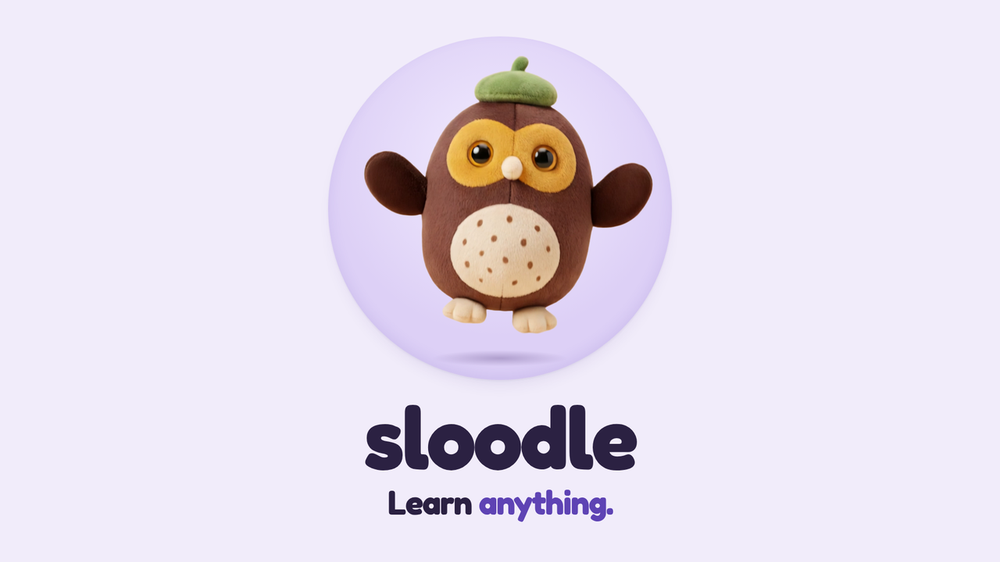
</p>
